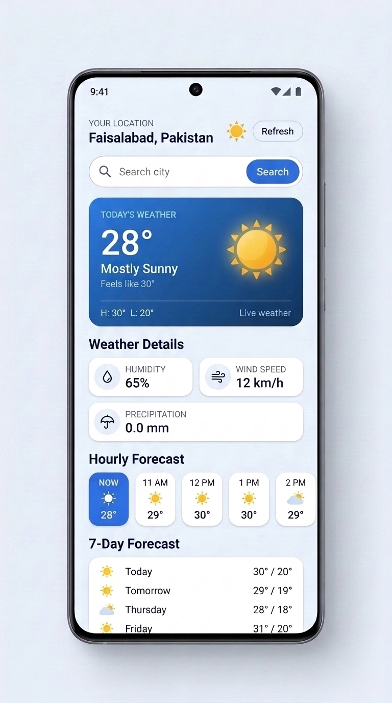
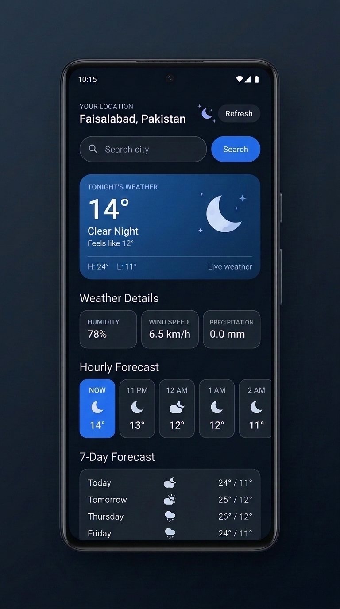

# WeatherApp 🌤️

> **Step 93** — Project overview  
> A polished Android weather app that delivers live conditions, an hourly strip, and a full 7-day forecast for any city on Earth — all with zero API keys required.

---

## Screenshots

<!-- Step 96: UI mockups generated during development -->

| Day Mode | Night Mode |
|:---:|:---:|
|  |  |

---

## Features

<!-- Step 94 — full feature list -->

| Category | Feature |
|----------|---------|
| **Weather data** | Live temperature, feels-like, humidity, wind speed, precipitation |
| **Forecasts** | Hourly forecast strip (24 h) · 7-day daily forecast with high/low |
| **Icons** | Animated vector icons mapped from WMO weather codes (clear, cloudy, rain, snow, thunder) |
| **Location** | GPS auto-detect · IP-based fallback if GPS is unavailable |
| **City search** | Real-time geocoding search with result list; tap to load weather |
| **Persistence** | Last selected city is saved and restored on relaunch (SharedPreferences) |
| **Themes** | Automatic day / night colour palette based on sunrise-sunset |
| **UX** | Pull-to-refresh · Search lens toggle (no permanent search bar) · Scroll-to-refresh arm |
| **Offline** | Graceful error messages · Retry via pull-to-refresh |
| **Accessibility** | Content descriptions on all icons; scalable text |
| **API** | [Open-Meteo](https://open-meteo.com/) (free, no key) · [Nominatim](https://nominatim.openstreetmap.org/) geocoding · `ip-api.com` IP fallback |

---

## Tech Stack

<!-- Step 93 — architecture overview -->

```
app/
├── api/            Retrofit interfaces (WeatherApi, GeocodingApi, IpLocationApi)
│                   RetrofitClient — shared OkHttp builder
├── adapters/       HourlyAdapter · DailyAdapter (RecyclerView)
├── models/         WeatherResponse · HourlyItem · DailyItem
│                   GeocodingResponse · IpLocationResponse · ApiError
└── utils/          LocationHelper   — FusedLocationProviderClient wrapper
                    WeatherCodeMapper    — WMO code → description string
                    WeatherCodeIconMapper — WMO code → drawable resource id
```

| Library | Version | Purpose |
|---------|---------|---------|
| Retrofit | 2.11.0 | HTTP client |
| Gson converter | 2.11.0 | JSON → Java models |
| Google Play Services Location | 21.3.0 | GPS / FusedLocationProvider |
| AndroidX RecyclerView | 1.4.0 | Hourly & daily forecast lists |
| Material Components | (via BOM) | Buttons, text fields |
| AppCompat | (via BOM) | AppCompatActivity base |

**Min SDK**: 24 (Android 7.0) · **Target SDK**: 37

---

## Setup Instructions

<!-- Step 95 -->

### Prerequisites

- **Android Studio** Ladybug (2024.2) or newer
- **JDK 11** (bundled with Android Studio JBR)
- An Android device or emulator running API 24+
- Internet connection (the app calls Open-Meteo at runtime)

### Clone & Open

```bash
git clone https://github.com/<your-username>/WeatherApp.git
cd WeatherApp
```

Open **Android Studio → File → Open** and select the `WeatherApp` folder.  
Android Studio will sync Gradle automatically.

### Run

1. Connect a device or start an emulator.
2. Click **Run ▶** (or press `Shift+F10`).
3. Grant **location permission** when prompted — the app will auto-detect your city.

### Permissions

| Permission | Why |
|------------|-----|
| `INTERNET` | Fetch weather data from Open-Meteo |
| `ACCESS_NETWORK_STATE` | Check connectivity before requests |
| `ACCESS_FINE_LOCATION` | Precise GPS coordinates |
| `ACCESS_COARSE_LOCATION` | Coarse location as fallback |

### No API key needed

WeatherApp uses [Open-Meteo](https://open-meteo.com/) (free, unlimited for non-commercial use) and [Nominatim](https://nominatim.openstreetmap.org/) for geocoding — no account or key required.

---

## Documentation

<!-- Step 97 -->

| Document | Location |
|----------|----------|
| Software Requirements Specification (SRS) | [`WeatherApp_SRS.docx`](WeatherApp_SRS.docx) |
| Testing: permission scenarios | [`docs/testing/permission-scenarios.md`](docs/testing/permission-scenarios.md) |
| Testing: offline scenarios | [`docs/testing/offline-scenarios.md`](docs/testing/offline-scenarios.md) |
| Release notes | [`docs/RELEASE_NOTES.md`](docs/RELEASE_NOTES.md) |

---

## License

This project is for educational purposes.
